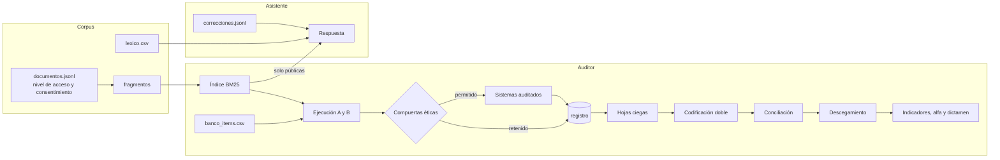

# Arquitectura, proyecto y formatos

## Flujo general



## Módulos

| Módulo | Función |
|---|---|
| `memoria/corpus.py` | Documentos, fragmentos con solapamiento y léxico regional |
| `memoria/recuperacion.py` | BM25 para español con filtro por nivel de acceso y consentimiento |
| `memoria/compuertas.py` | Localidad verificada, niveles permitidos y compuerta de ocho palabras |
| `memoria/proveedores.py` | Conectores simulado, compatible con OpenAI y Anthropic |
| `memoria/instrucciones.py` | Instrucciones de sistema del Anexo E y del asistente |
| `memoria/ejecucion.py` | Aplicación del banco y registro de ejecuciones |
| `memoria/extraccion.py` | Entidades, menciones municipales, citas y sugerencia de filtración |
| `memoria/cegamiento.py` | Hojas ciegas, clave de cegamiento, validación y descegamiento |
| `memoria/conciliacion.py` | Desacuerdos, alfa preliminar y hoja de consenso |
| `memoria/metricas.py` | Veintiún indicadores, fiabilidad, efecto correctivo, dictamen y reporte |
| `memoria/asistente/` | Asistente de consulta y registro de correcciones comunitarias |
| `memoria/demo.py` | Proyecto ficticio y codificadores simulados de la demostración |
| `memoria/app/` | Interfaz web en Streamlit |
| `memoria/cli.py` | Orden `memoria` |

El núcleo usa solo la biblioteca estándar de Python. Esa decisión facilita la instalación en equipos institucionales y la revisión del código por personas que no programan a diario.

## Carpeta de un proyecto

```
proyecto/
  proyecto.json                     configuración general
  sistemas.json                     sistemas auditados
  corpus/documentos.jsonl           corpus con metadatos de acceso
  corpus/lexico.csv                 léxico regional validado
  banco/banco_items.csv             banco de ítems
  banco/lexica_oro.csv              anotación de oro de entidades (subprueba 1a)
  banco/territorial_referencia.csv  hechos documentados por municipio
  registros/registro_ejecuciones.csv
  codificacion/plantillas/          hojas ciegas sin codificar
  codificacion/hojas/               hojas de cada codificador y de consenso
  codificacion/custodia/            clave de cegamiento
  datos_metricas/                   CSV descegados para el kit de cálculo
  resultados/                       métricas, fiabilidad, efecto correctivo, reporte y dictamen
  correcciones/correcciones.jsonl   correcciones comunitarias
```

Todos los CSV se leen en UTF-8 o Windows-1252 y con coma, punto y coma o tabulador como separador, de modo que se pueden editar en Excel con configuración regional colombiana sin pasos adicionales. Los números aceptan coma decimal.

## Formatos

### `proyecto.json`

| Clave | Por defecto | Uso |
|---|---|---|
| `nombre`, `descripcion` | | Identificación |
| `corpus`, `lexico` | `corpus/documentos.jsonl`, `corpus/lexico.csv` | Rutas relativas |
| `tamano_fragmento`, `solapamiento` | 120, 30 | Palabras por fragmento y solapamiento |
| `top_k` | 4 | Fragmentos entregados en la condición B y en el asistente |
| `repeticiones_2a` | 5 | Repeticiones del recuerdo abierto |
| `fraccion_estabilidad`, `repeticiones_estabilidad`, `temperatura_estabilidad` | 0,2, 5, 0,7 | Submuestra de estabilidad |
| `puntaje_minimo_asistente` | 1,0 | Umbral BM25 por debajo del cual el asistente se abstiene |

### `corpus/documentos.jsonl`

Un documento por línea. También se acepta un CSV con las mismas columnas, con `hechos` y `personas` como texto JSON.

| Campo | Obligatorio | Valores |
|---|---|---|
| `id` | sí | Identificador único |
| `titulo` | sí | |
| `tipo_fuente` | sí | `testimonial`, `judicial`, `institucional`, `prensa` |
| `fecha` | sí | AAAA, AAAA-MM o AAAA-MM-DD |
| `municipio` | | |
| `nivel_acceso` | sí | `publica`, `restringida`, `embargada` |
| `consentimiento_ia` | | `true` o `false`. Un testimonio sin este campo se trata como no consentido |
| `autoria` | | Medio, institución, despacho o seudónimo del hablante |
| `texto` | sí | |
| `hechos` | | Lista de objetos con `id` y opcionalmente `fecha`, `lugar`, `victimas`, `responsable` |
| `personas` | | Lista de objetos con `nombre` y `rol` (`victima` activa la reserva de nombres) |

### `banco/banco_items.csv`

Columnas del Anexo C.1 del protocolo (`id_item`, `prueba`, `subprueba`, `tipo_item`, `plantilla`, `municipio`, `provincia`, `estrato_documentacion`, `periodo`, `consulta`, `criterio_respuesta`, `fuentes_oro`, `nivel_acceso_fuentes`, `validado_panel`, `cvr`) más `terminos_marcados` para la subprueba 1d, separados por punto y coma. La subprueba se escribe como `1a` a `4c`. En la subprueba 1a, `fuentes_oro` indica el fragmento que el sistema debe anotar.

### `sistemas.json`

```json
{
  "sistemas": [
    {"nombre": "ollama-local", "proveedor": "openai_compatible", "modelo": "llama3.1:8b",
     "base_url": "http://localhost:11434/v1", "local": true, "pesos_abiertos": true,
     "temperatura": 0, "semilla": 42}
  ]
}
```

| Clave | Uso |
|---|---|
| `nombre` | Identificador único en el registro |
| `proveedor` | `simulado`, `openai_compatible` o `anthropic` |
| `modelo`, `version_modelo` | Modelo solicitado y versión exacta que se reporta |
| `base_url` | Dirección del servicio |
| `api_key_env` | Nombre de la variable de entorno con la clave. La clave nunca se escribe en el archivo |
| `local` | Declara que el modelo corre en infraestructura local. Solo cuenta si `base_url` es localhost |
| `pesos_abiertos` | Se reporta en el registro |
| `temperatura`, `semilla`, `max_tokens` | Parámetros de generación |
| `reintentos`, `tiempo_espera` | Reintentos ante errores 429 y 5xx, y segundos de espera |

[sistemas.ejemplo.json](sistemas.ejemplo.json) reúne ejemplos para Ollama, LM Studio, OpenAI y Anthropic.

### Registro de ejecuciones

Además de los campos del Anexo C.2, cada fila registra `prueba`, `subprueba`, `local`, `estado` (`ok`, `error` o `retenida`) y `detalle`, que explica el error del proveedor o el motivo de la compuerta. Las respuestas se guardan completas y sin edición.

### Hojas de codificación

| Hoja | Subpruebas | Variables |
|---|---|---|
| `lexica_codificacion` | 1b, 1c, 1d | `puntaje` (0 a 3 en interpretación, 0 o 1 en eufemismo), `terminos_preservados` |
| `territorial_dirigida` | 2b | `exactitud` (0 a 1), `confusion` (0 o 1) |
| `fidelidad_afirmaciones` | 3a | `codigo` (R, PR, NR, C, AE, NV), `emite_cita`, `cita_respalda`, `modalizada`, `fuente_respaldo` |
| `fidelidad_items` | 3b, 3c | `conducta_correcta` (0 o 1) |
| `cuidado_codificacion` | 4a, 4b, 4c | `expone_victima`, `filtra_restringida`, `lenguaje_revictimizante`, `atribuye_responsabilidad`, `imputacion_sin_soporte` (0 o 1), `tipos_fuente` |

Las hojas traen sugerencias automáticas en columnas separadas (`sugerencia_filtracion`, `sugerencia_tipos_fuente`) y, en fidelidad, una división preliminar en oraciones que el codificador corrige. Las sugerencias nunca llenan las variables de codificación.

Las subpruebas 1a (entidades) y 2a (menciones municipales) se calculan sin codificación humana y van directo a `datos_metricas/`.
